<picture><source media="(prefers-color-scheme: dark)" srcset="assets/header-dark.svg"></picture>

<picture><source media="(prefers-color-scheme: dark)" srcset="assets/ticker-dark.svg"></picture>

 

<a href="https://naimkhrof.com"><picture><source media="(prefers-color-scheme: dark)" srcset="assets/work-01-dark.svg"></picture></a> <a href="https://cyclem.ch"><picture><source media="(prefers-color-scheme: dark)" srcset="assets/work-02-dark.svg"></picture></a> <a href="https://privigo.fr"><picture><source media="(prefers-color-scheme: dark)" srcset="assets/work-03-dark.svg"></picture></a>

  

naimkhrof.com · LinkedIn

© 2026 Naïm Khrof

